# GapLens

**Find what your sources hide.** Built for the Shinchan Online Hackathon 2026, problem statement *Digital Dark Spot: AI-Assisted Information Gap Detection Platform*.

**Live:** https://gaplens-nine.vercel.app · **Launch film:** [watch (45 s)](https://gaplens-nine.vercel.app/gaplens-demo-1080.mp4)

[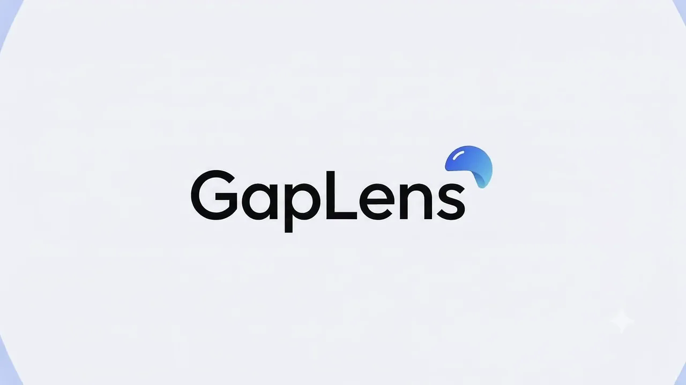](https://gaplens-nine.vercel.app/gaplens-demo-1080.mp4)

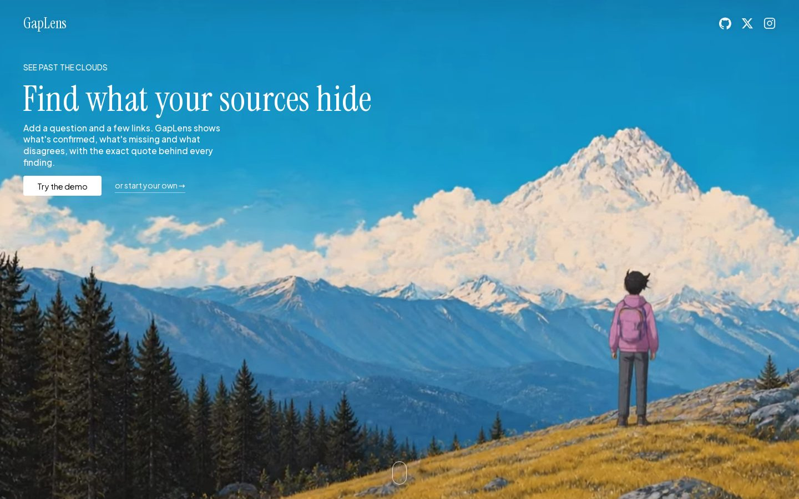

Scroll past the hero for the story: a statement over a fixed ember video, a cursor-following ink trail that reveals the "dark spots", a four-step "How it works" rail, features, who it's for, and a final call to action.

| Cursor ink reveal | How it works |
|---|---|
| 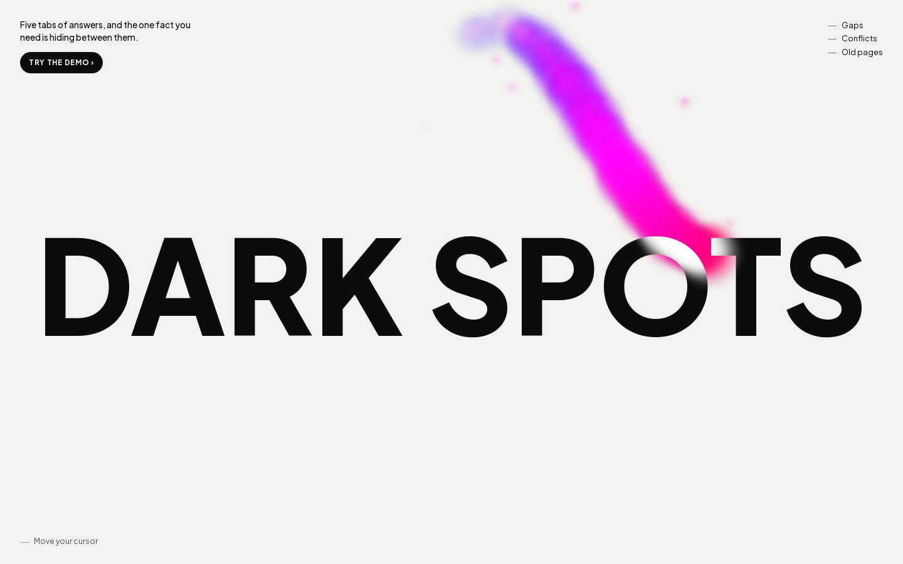 | 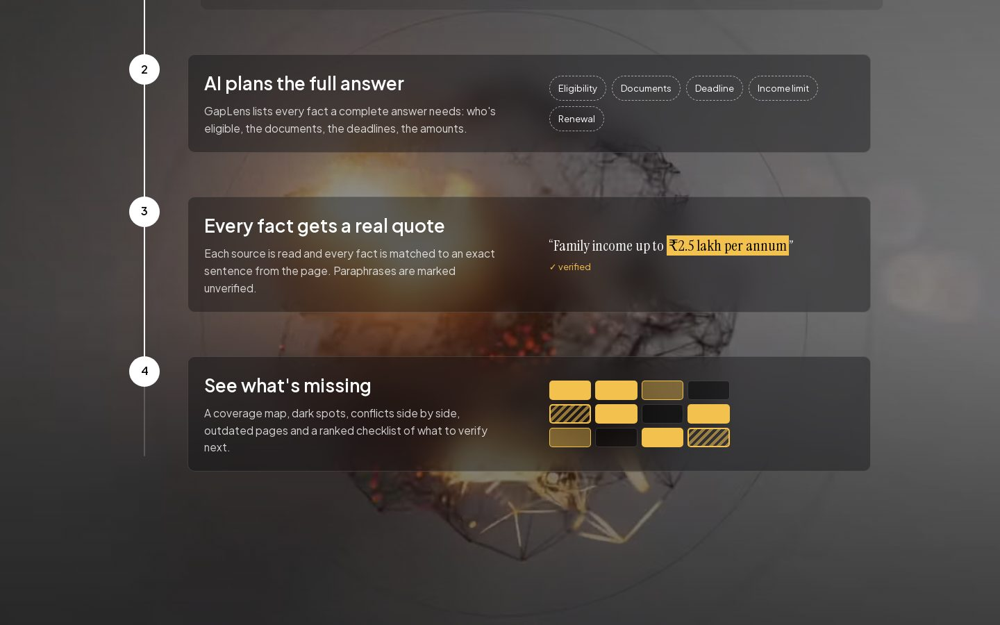 |

Give GapLens a question and 2 to 6 sources (links or pasted text). It returns:

- **Confirmed facts**, each with the exact quote and a link to the page it came from. Quotes are checked against the source text in code; anything the model paraphrased is marked unverified.
- **Dark spots**: parts of a complete answer that no source covers, plus parts only one source mentions.
- **Conflicts**: places where sources disagree, quoted side by side.
- **Outdated or undated** sources.
- A **coverage score and map** (aspect × source), computed deterministically from verified evidence.
- A prioritised **Verify next** checklist you can tick off.
- English and Hindi, for the interface and the report.

### Made to be easy

- **One-tap demo**: a saved scholarship analysis over four real pages, no waiting on the API.
- **Example questions** that fill in the question and real sources for you.
- **Paste many links at once**, one per line or separated by spaces. Duplicates are skipped.
- **Paste text instead** when a site blocks reading or the source is a PDF.
- **Recent questions** are kept on your device, so you can reopen a report later.
- **Share the checklist**: copy it, send it on WhatsApp, save the report as PDF, or export Markdown.
- **Ctrl + Enter** runs the analysis from the question box.
- Works on phones: the coverage map scrolls sideways and quotes open as a bottom sheet.

## Screenshots

| Results | Evidence with the exact quote |
| --- | --- |
| 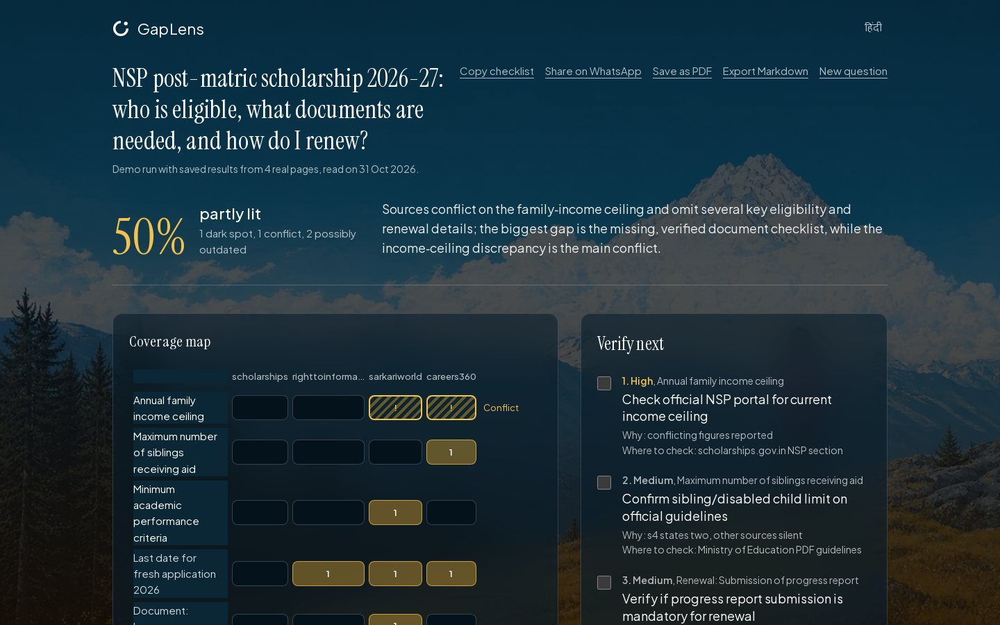 | 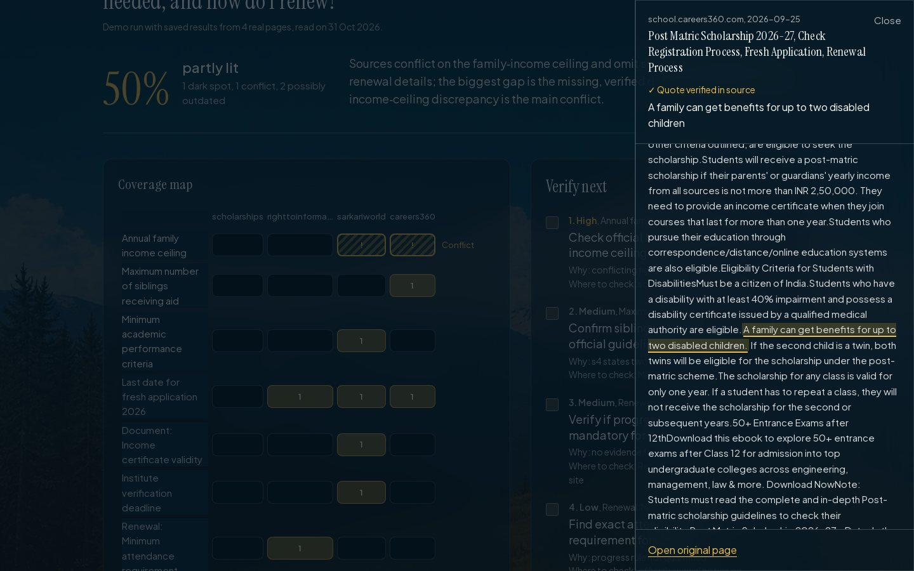 |
| **Conflicts side by side** | **Hindi** |
| 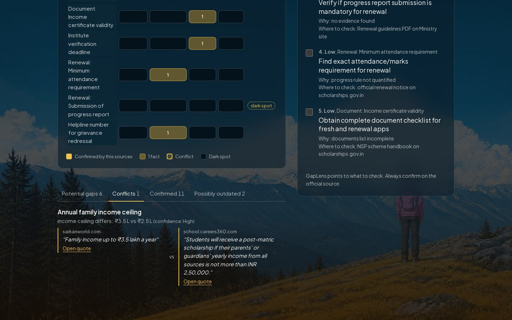 | 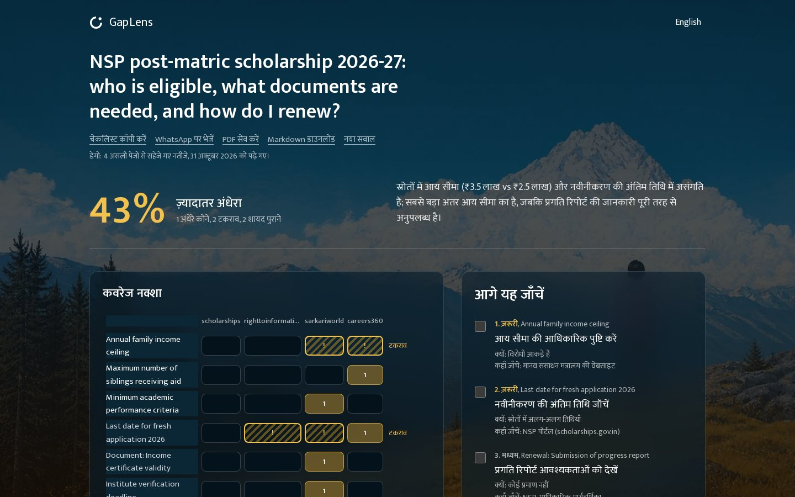 |
| **Workspace with real sources** | |
| 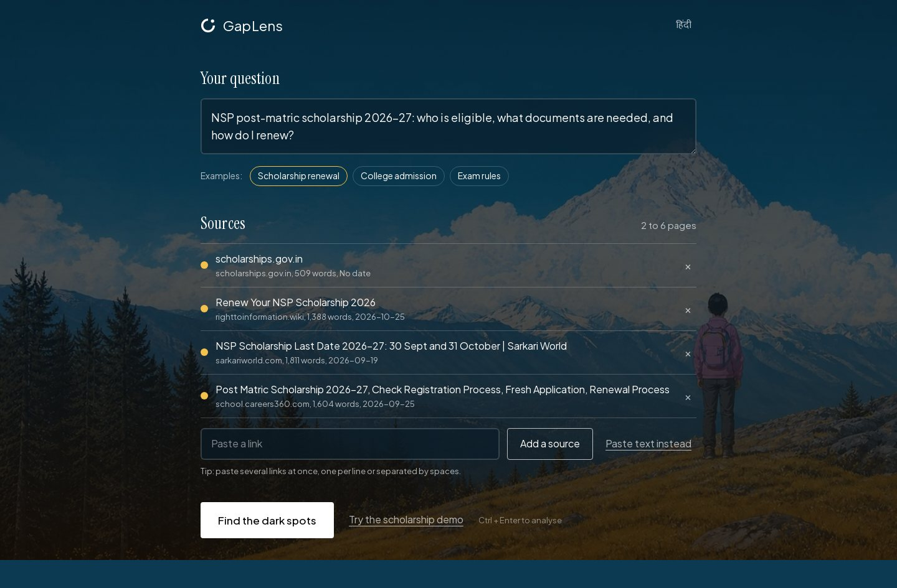 | |

### Mobile

| Landing | Results | Quote sheet | Conflicts | Hindi |
| --- | --- | --- | --- | --- |
| 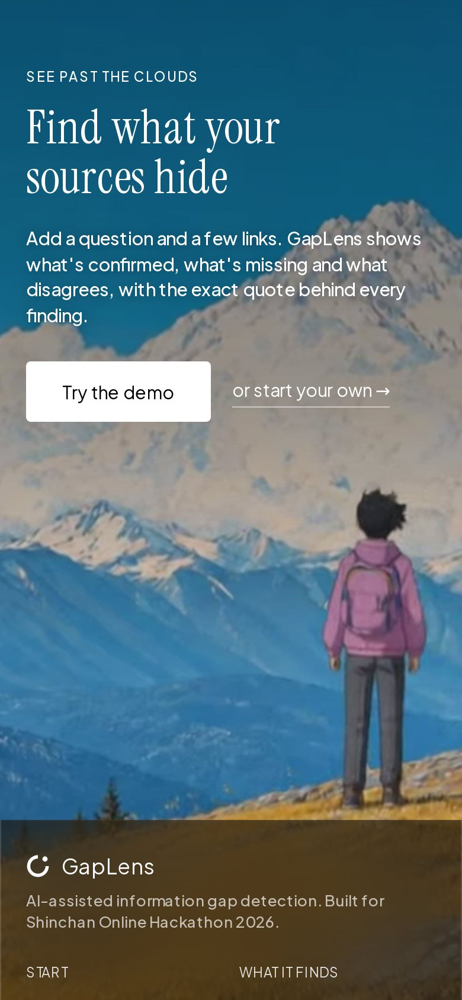 | 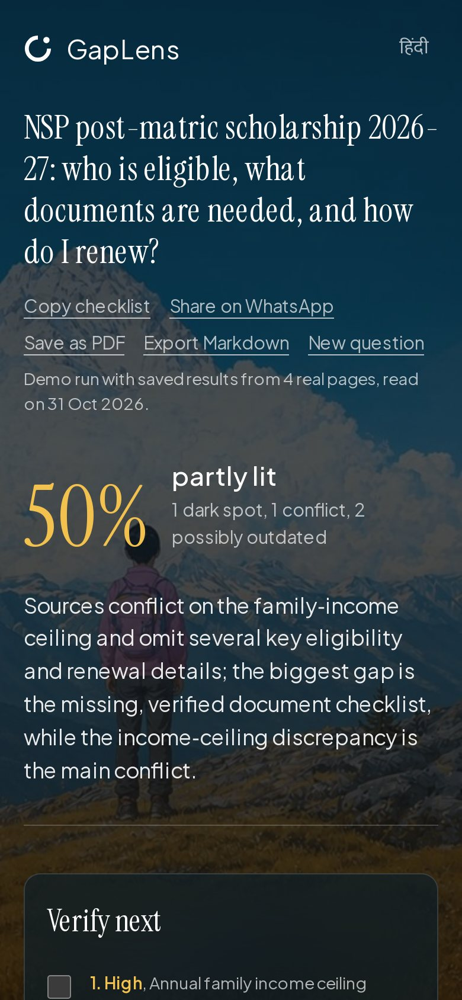 | 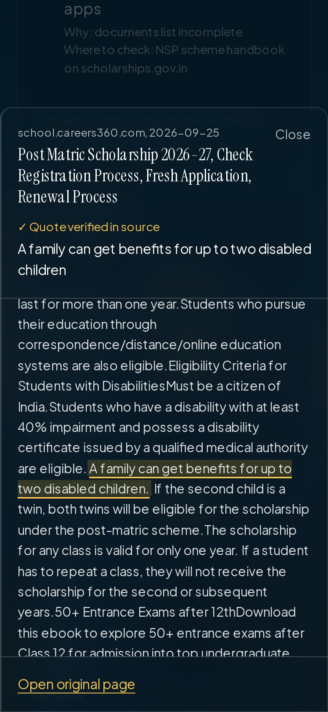 | 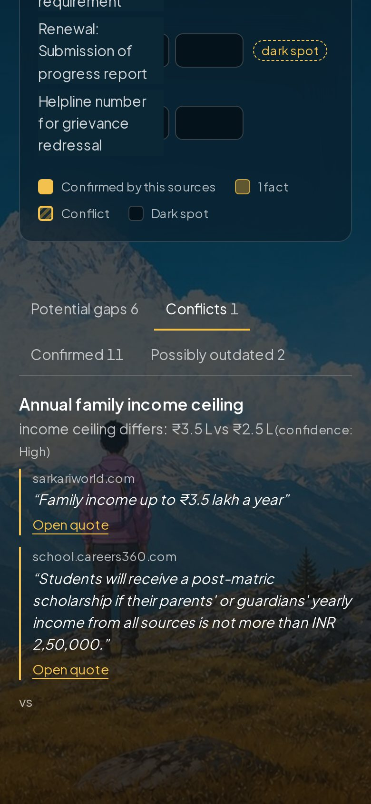 | 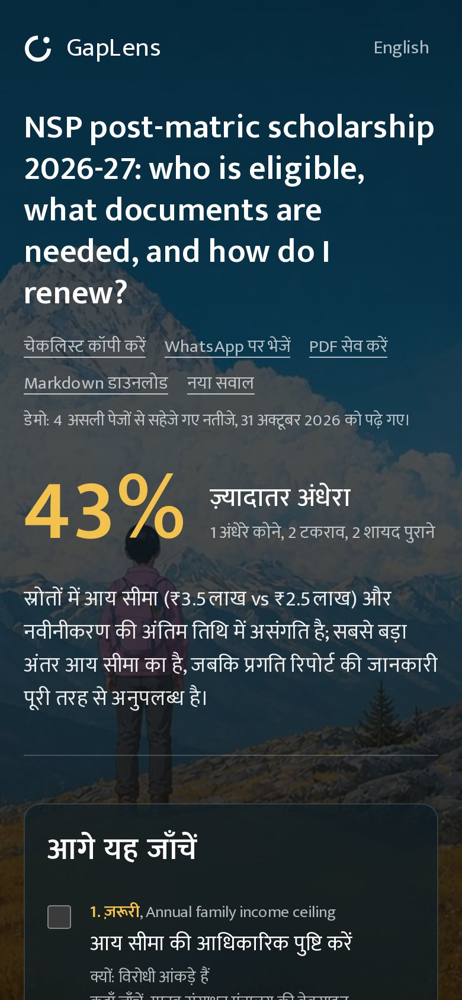 |

Screen recordings of the full flow: [desktop](docs/video/gaplens-desktop.mp4) · [mobile](docs/video/gaplens-mobile.mp4)

## How it works

1. **Read**: server-side extraction with Mozilla Readability + linkedom. Blocks private/local addresses, 12 s timeout, 2.5 MB cap, paste-text fallback for PDFs and blocked pages.
2. **Plan**: an LLM lists the specific, checkable facts a complete answer needs.
3. **Evidence**: per source, the most relevant passages are selected in code and the LLM extracts facts with verbatim quotes. `verifyQuote` checks every quote against the page.
4. **Synthesise**: the LLM proposes conflicts and gap notes; coverage, status and score are computed in code from verified facts only.

LLM: Groq (`openai/gpt-oss-120b`, fallbacks `openai/gpt-oss-20b`, `qwen/qwen3.8-27b`).

Stack: Next.js 15 (App Router), TypeScript, Tailwind CSS v4, Groq, deployed on Vercel.

## Run locally

```bash
npm install
echo "GROQ_API_KEY=your_key" > .env.local
npm run dev
```

The scholarship demo (`/demo/*.json`) is a saved run over four real pages read on 31 Oct 2026, so judges can see a full report without waiting on the API.

## Credits

- Landing layout adapted from a cinematic "Nexeus" hero brief; painted panorama video and poster from that brief.
- Design review guided by [unslop](https://github.com/heydamir/unslop) by @heydamir.
- Fonts: Instrument Serif, Plus Jakarta Sans, Mukta (Google Fonts).

## Limits

GapLens flags *potential* gaps and conflicts. It is a research aid, not legal or official advice; always confirm on the official source.
